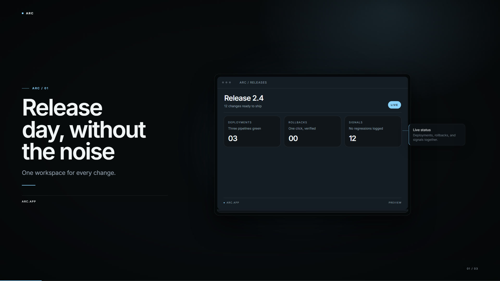
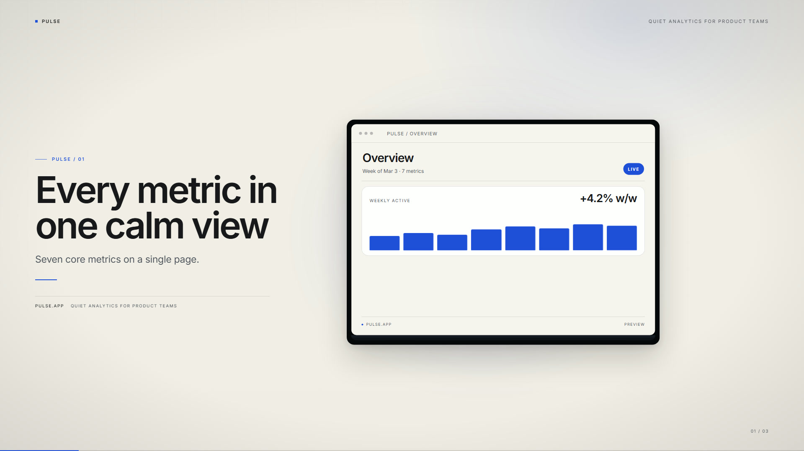
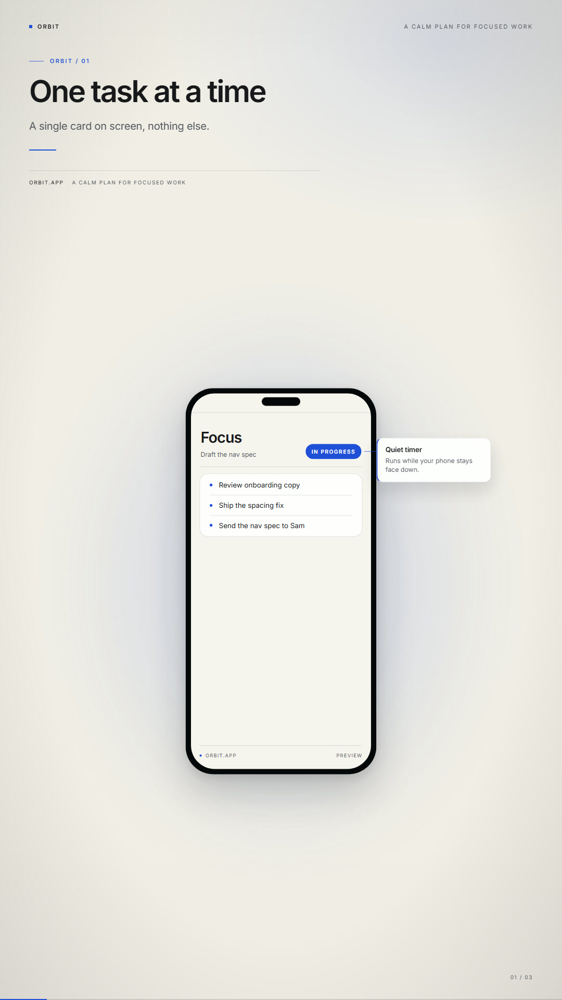

# Auteur

**Model-agnostic product/UI motion graphics studio.**  
A brief becomes a typed `VideoPlan`, then deterministic HTML/GSAP, then an MP4 — with a visual QA and fix loop.

Auteur is built on one observation: Claude Opus 5.5 is not a video model. It writes code that a renderer turns into video. The quality comes from taste, constraints, and iteration — not from asking a model to one-shot a 60-second film. Auteur externalizes those constraints into templates and a critic loop, so a relay with ordinary models can produce work that looks art-directed.

> Status: 3-day vertical slice complete. One product/UI template. Three real briefs generated through an OpenAI-compatible relay, all at QA 100/100 after template fixes. Generated ambient score + SFX, normalized to −16 LUFS. Benchmark 01 is a public ToDopa concept study, not a blind Opus parity test.

<p align="center">
  
  
</p>
<p align="center">
  
</p>

### Real runs

| Brief | Format | Video | QA |
|---|---|---|---|
| Arc — release cockpit | 1920×1080 | [MP4](docs/media/arc.mp4) | 100/100 |
| Pulse — weekly analytics | 1920×1080 | [MP4](docs/media/pulse.mp4) | 100/100 |
| Orbit — mobile focus | 1080×1920 | [MP4](docs/media/orbit.mp4) | 100/100 |

The videos above were generated by a free DeepSeek V4.1 Flash routing model, not by Opus 5.5. The quality comes from the template system and the critic loop, not from a frontier video model.

### What the real runs caught

- **Arc**: the model copied a scene headline into `brand.tagline`, so the same line appeared three times. Normalization now drops a tagline that repeats a headline.
- **Pulse**: paper-theme muted text failed WCAG at 4.21:1, and a scene without cards triggered a GSAP warning for `.ui-card`. The token contrast and the conditional animation setup were fixed in the template.
- **Orbit**: the 9:16 deck inherited `align-items: center`, which shrank the stage to the phone width and pushed the callout on top of the screen. The phone chrome title was also hidden behind the notch. Both are fixed; the callout now sits outside the device.

### Audio

A deterministic ambient bed and UI whooshes/ticks are generated with FFmpeg at render time. No third-party audio, no sample licensing. The mix targets −16 LUFS / −1.5 dBTP; `qa` measures integrated loudness and true peak. Levels live in [config/audio.json](config/audio.json). There is no voiceover yet.

### Benchmark 01 — ToDopa concept

The public [ToDopa post](https://x.com/eta1ia/status/2103779108438077923) describes "BeReal for tasks" and says the app was finished with Opus 5.5. Its prompt is not public and the original is a 59-second screen recording. We wrote a new 12-second concept brief and generated a 9:16 product film with Auteur.


- [Watch the Auteur version](bench/media/todopa-bench.mp4)
- [Read the methodology and honest limitations](bench/README.md)
- Original prompt: not public. This is a concept adaptation, not a controlled reproduction or a blind human study.
- Self-assessment: 20/25 on the Code2Video axes; the model invented one privacy claim that human review removed before publishing.

## How it works

```
brief
  → director model (VideoPlan JSON)
  → template compiler (typed scene graph → HTML/CSS/GSAP)
  → HyperFrames render (headless Chrome + FFmpeg)
  → critic (DOM + media + HyperFrames check)
  → deterministic fixes (JSON Patch)
  → re-render
```

The model never writes HTML or CSS. It fills a constrained `VideoPlan`: scenes, copy, UI blocks, callouts, camera keys, transitions. Layout, type scale, easing, safe areas, and motion are owned by the template. That is what makes a weaker model usable.

## Requirements

- Node.js 22+
- FFmpeg and FFprobe on `PATH`
- Chrome/Chromium for HyperFrames; Playwright Chromium for DOM audits
- `pnpm`

## Quickstart (no model required)

```bash
pnpm install
pnpm exec playwright install chromium
pnpm run render -- --plan examples/plan-arc.json --quality draft
pnpm run qa -- --run arc-release
```

Outputs:

- `runs/arc-release/out/video.mp4`
- `runs/arc-release/composition/index.html`
- `runs/arc-release/qa.json` and `qa.md`
- `runs/arc-release/frames/contact-sheet.jpg`

Preview with a timeline scrubber:

```bash
pnpm run preview -- --plan examples/plan-arc.json
# open the printed http://127.0.0.1:4321/?preview=1
```

## Real generation with your relay

Auteur is OpenAI-compatible and multi-model. You can use different models for directing, fixing, and visual review.

```bash
cp .env.example .env.local
# Fill AUTEUR_RELAY_BASE_URL, AUTEUR_RELAY_API_KEY, and model names.
pnpm run doctor
pnpm run make -- --brief briefs/arc.md --out arc
```

`.env.local` is gitignored. Never commit it.

### Roles and fallbacks

`config/models.json` defines model entries. `config/roles.json` maps roles to fallback chains:

```json
{
  "director": { "chain": ["director-primary", "director-fallback"], "temperature": 0.35, "maxTokens": 8000 },
  "fixer":    { "chain": ["coder-primary"], "temperature": 0.2, "maxTokens": 6000 },
  "critic":   { "chain": ["vision-primary"], "temperature": 0.2, "maxTokens": 4000 }
}
```

`doctor` probes `/v1/models`, JSON output, and image input, and writes `config/capabilities.local.json`. If no vision model is available, visual review is skipped and the deterministic DOM/media checks still run.

## What the critic checks

- **DOM**: horizontal overflow, clipped text, callout/copy overlap, safe margins, minimum type sizes.
- **Media**: resolution, fps, duration, frame count, black frames, integrated loudness, true peak.
- **HyperFrames check**: runtime errors, layout occlusion, container overflow, WCAG contrast, motion.
- **Fixer**: converts actionable issues into JSON Patch operations, validates the patched plan, re-renders, and reports the score delta.

The local example passes 100/100. The score is a guardrail, not a substitute for human taste.

### Evidence

- [Arc QA report](docs/qa/arc-real.md) — 100/100, 12s, audio −15.9 LUFS
- [Pulse QA report](docs/qa/pulse-real.md) — 100/100, 10.2s
- [Orbit QA report](docs/qa/orbit-real.md) — 100/100, 12s, 1080×1920
- [ToDopa QA report](docs/qa/todopa-bench.md) — 100/100, 12s, 1080×1920
- [Fix loop evidence](docs/qa/fix-loop.md) — 95 → 100, one JSON Patch

### Fix loop demo

The deliberate `examples/plan-overflow.json` fixture scores **95/100** with a 45px headline overflow. One patch reduces `headlineScale` from 1.20 to 1.08; the re-render passes **100/100**. The original and fixed videos are kept separately.

```bash
pnpm run render -- --plan examples/plan-overflow.json
pnpm run qa -- --run overflow-demo
pnpm run fix -- --run overflow-demo
# runs/overflow-demo/out/video.mp4 and video.fixed.mp4
```

## Commands

| Command | Purpose |
|---|---|
| `pnpm run doctor` | Check Node/FFmpeg/HyperFrames/Playwright, relay config, model capabilities |
| `pnpm run plan -- --brief briefs/arc.md --out arc` | Brief → `runs/arc/plan.json` |
| `pnpm run render -- --plan examples/plan-arc.json` | Plan → composition → MP4 |
| `pnpm run preview -- --plan examples/plan-arc.json` | Local preview with scrubber |
| `pnpm run qa -- --run arc` | DOM + media + HyperFrames audit |
| `pnpm run fix -- --run arc` | Apply deterministic fixes and re-render |
| `pnpm run make -- --brief briefs/arc.md --out arc` | Plan → render → QA → fix |
| `pnpm test` | Unit tests: schema, determinism, URL/JSON helpers, fixer |
| `pnpm e2e` | Local render + QA assertion |

## Project layout

```
src/
  cli/            command line entry
  models/         OpenAI-compatible client, registry, probes
  plans/          VideoPlan schema and normalization
  director/       brief → plan
  templates/      design tokens and product/UI template
  compose/        deterministic HTML writer
  render/         HyperFrames adapter and preview server
  audio/          generated ambient bed + SFX mixer
  critique/       DOM, media, HyperFrames checks, report
  fix/            JSON Patch fixer
bench/            public concept study and media
docs/             README screenshots and sample MP4s
scripts/          snapshots, preview check, e2e
examples/         example plans
briefs/           product briefs
runs/             generated artifacts (gitignored)
```

## Current limitations

- One template and English copy in the slice; CJK font subsetting is not packaged yet.
- No voiceover/TTS, no timeline editor, no Tauri shell. Music and SFX are synthesized, not composed tracks.
- VLM review is optional; the current relay's vision slot is rate-limited, so scoring uses deterministic DOM/media/HyperFrames checks, plus audio loudness/peak.
- Motion graphics only: UI, typography, charts, product surfaces. No photorealistic footage.
- The QA score can be gamed by a clean but boring composition. Human review is still required.

## Roadmap

1. 5 templates: product UI, dashboard, mobile, kinetic type, social hook.
2. Voiceover/TTS, ducking, and beat-synced SFX; the generated bed/SFX layer already exists.
3. Local Studio: scene inspector, timeline scrub, issue list, one-click fix/render.
4. Controlled benchmarks: same prompt and duration when public prompts are available; Code2Video five-axis scoring; cost/time.
5. Integrations: OpenMontage, Remotion adapter, GitHub Action.
6. Tauri desktop shell and brand kits.

## Security

- Keys live only in `.env.local` / environment variables. They are never logged or written into compositions.
- Generated compositions make no network requests. GSAP and fonts are local files.
- The slice does not execute model-written code; it only consumes typed JSON.
- `runs/` and local capability files are gitignored.

## License

MIT. See [LICENSE](LICENSE) and [THIRD_PARTY.md](THIRD_PARTY.md). Dependencies such as HyperFrames, GSAP, Inter, and FFmpeg keep their own licenses. No third-party audio or original Opus videos are bundled.

---

### 中文快速开始

```bash
pnpm install
pnpm run render -- --plan examples/plan-arc.json --quality draft
pnpm run qa -- --run arc-release
```

真实生成时，把中转站的 base URL、key、model 名称写进 `.env.local`，然后：

```bash
pnpm run doctor
pnpm run make -- --brief briefs/arc.md --out arc
```

模型只输出受约束的 `VideoPlan`，不写 HTML/CSS；模板和审片循环负责质量下限。
