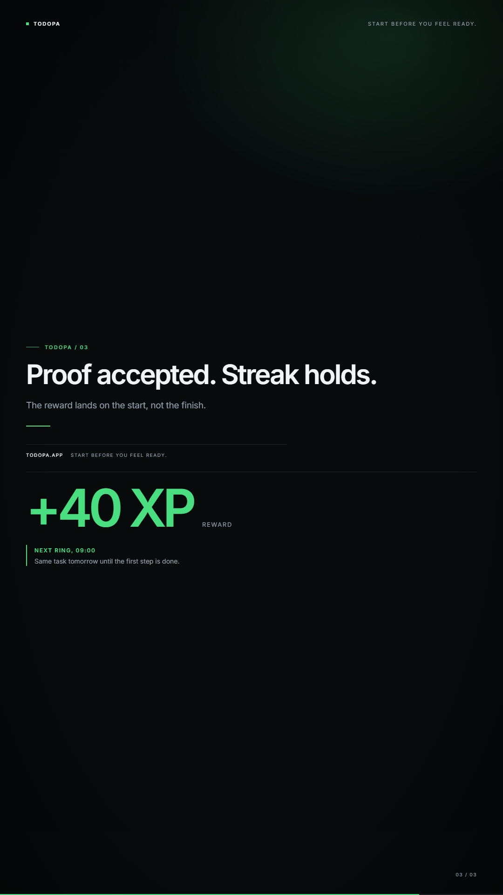

# Benchmark 01 — ToDopa concept adaptation

This is a **public concept study**, not a controlled prompt reproduction and not a blind human preference test.

The original ToDopa post by [@eta1ia](https://x.com/eta1ia/status/2103779108438077923) describes a "BeReal for tasks": at a scheduled time the app rings until you show proof you started; proof earns a reward. The post says the app was finished with Opus 5.5. The original video is a **59-second screen recording of the real app**. Its prompt is not public.

We took the public concept, wrote a new 12-second product-film brief, and generated it with Auteur using a free DeepSeek V4.1 Flash routing model (not Opus 5.5).

| | Original | Auteur adaptation |
|---|---|---|
| Format | 59s real app screen recording | 12s product/UI film |
| Prompt | Not public | [Public concept brief](prompts/todopa.md), written by us |
| UI | Real app: timer, camera feed, progress, reward | Reconstructed UI: timer, proof chart, reward cards |
| Motion | Real screen recording and app transitions | 3 scenes, camera pushes, callouts, transitions |
| Audio | Not evaluated | Generated ambient bed + 5 SFX, −16 LUFS |
| QA | n/a | 100/100 (DOM, media, HyperFrames, loudness) |



[Watch the Auteur version](media/todopa-bench.mp4) · [QA report](../docs/qa/todopa-bench.md)

## What matched

- The concept is legible in 12 seconds: a task is due, proof is required, the reward lands.
- The green accent and dark UI carry the "dopamine loop" idea without looking like a generic AI demo.
- The phone layout, callouts, and generated sound make it feel like a finished product film rather than a code demo.

## What did not match

- The original is a **real app recording**; ours is a reconstructed UI in a phone frame. It has no camera feed, no real notification, and no actual task interaction.
- The original is 59 seconds and can show a full loop; ours is three four-second beats.
- The model invented a privacy claim during generation ("the frame is scored locally, then discarded"). That was not in the brief and is not verified; we replaced it with "A single frame clears the check" before publishing. This is a concrete example of why human review remains mandatory.
- The generated score is a simple ambient bed, not a composed track.

## Self-assessment

These are our own 1–5 ratings for the Auteur version, using the Code2Video axes. We do not score the original because we did not run the same prompt or a blind viewing study.

| Axis | Score | Note |
|---|---|---|
| Engagement | 4/5 | Clear hook and reward; could use a stronger final CTA. |
| Intent | 4/5 | Concept is clear; one invented claim was removed. |
| Composition | 4/5 | Strong type and callout/phone balance; the lower phone area is sparse. |
| Temporal flow | 4/5 | Three clean beats; the original's longer loop has more variation. |
| Craft | 4/5 | Clean render, audio, and QA; the generated bed is intentionally simple. |
| **Total** | **20/25** | |

## Honest conclusion

Auteur can turn a public product concept into a coherent, polished 12-second product film in one run, with audio and a 100/100 automated QA. It cannot reproduce a 59-second real app screen recording or the original's camera interaction with this template.

This study does **not** show that Auteur has matched Opus 5.5. A real parity test needs the same prompt, the same duration, the same assets, and blind human preference scoring. If the original authors publish their prompts, we will run that test.

## Reproduce

```bash
pnpm run make -- --brief bench/prompts/todopa.md --out todopa-bench --ratio 9:16 --quality draft
pnpm run qa -- --run todopa-bench
```

The model output is a `VideoPlan`; the template, type, motion, and audio are deterministic. The only manual edit in this study was removing the invented privacy claim.
